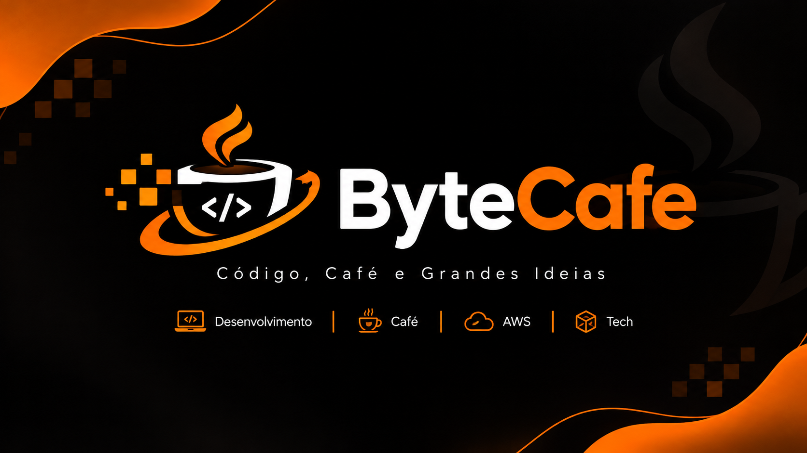

# ☕ ByteCafeTech

### Código, Café e Grandes Ideias.

**Transformando ideias em soluções tecnológicas.**

---

## 🚀 Sobre a ByteCafeTech

A **ByteCafeTech** é uma organização dedicada à engenharia de software, experimentação tecnológica e desenvolvimento de soluções modernas.

Nosso propósito é transformar ideias em aplicações reais, explorando arquitetura de software, sistemas distribuídos, automação e computação em nuvem.

Mais do que desenvolver aplicações, buscamos construir soluções que representem cenários reais de mercado, aplicando boas práticas de engenharia e tecnologias utilizadas na indústria.

Acreditamos que grandes soluções começam com boas ideias, boas tecnologias e, claro, um bom café. ☕

## 🎯 Nossa missão

- Desenvolver aplicações modernas, seguras e escaláveis.
- Explorar arquiteturas distribuídas e microsserviços.
- Aplicar boas práticas de engenharia de software.
- Construir soluções utilizando cloud computing.
- Experimentar novas tecnologias e arquiteturas.
- Transformar projetos de estudo em produtos com potencial comercial.
- Compartilhar conhecimento através de projetos práticos.

## 🛠️ Stack tecnológica

| Tecnologia | Aplicação |
|---|---|
| Java | Desenvolvimento backend |
| Python | Automação e serviços |
| Spring Boot | APIs e microsserviços |
| AWS | Infraestrutura em nuvem |
| Apache Kafka | Mensageria e eventos |
| Docker | Containerização |
| PostgreSQL | Banco de dados relacional |
| GitHub Actions | CI/CD |

## 📦 Projetos

### ☕ ByteCafe E-commerce

O **ByteCafe E-commerce** é um projeto de desenvolvimento de uma plataforma de comércio eletrônico, criado inicialmente com o propósito de estudo, experimentação e evolução de práticas de engenharia de software.

A proposta é simular um cenário real de negócio, desenvolvendo uma aplicação que permita explorar tecnologias modernas, arquitetura de sistemas e boas práticas utilizadas no mercado.

Embora tenha começado como um projeto de aprendizado, sua arquitetura e evolução são pensadas para permitir que futuramente ele possa se transformar em uma plataforma de e-commerce real.

#### 🎯 Objetivos técnicos

- Desenvolver uma plataforma de comércio eletrônico.
- Criar APIs REST.
- Trabalhar com arquitetura de software sustentável.
- Explorar comunicação síncrona e assíncrona.
- Implementar mensageria utilizando Apache Kafka.
- Integrar serviços e infraestrutura AWS.
- Implementar persistência e gerenciamento de dados.
- Desenvolver testes automatizados.
- Implementar pipelines de CI/CD.
- Trabalhar com segurança, observabilidade e escalabilidade.

#### 🧰 Tecnologias planejadas

- Java e Spring Boot.
- Python.
- PostgreSQL.
- Apache Kafka.
- AWS.
- Docker.
- GitHub Actions.

## 🏗️ Engenharia de software

Nossos projetos buscam aplicar conceitos e práticas que contribuem para a construção de sistemas robustos e sustentáveis.

**Princípios e padrões:**

- Clean Architecture.
- Domain-Driven Design (DDD).
- SOLID.
- Design Patterns.
- Event-Driven Architecture.
- Modular Monolith.
- Microsserviços.
- Testes automatizados.
- Observabilidade.
- Continuous Integration e Continuous Delivery.

## 📈 Evolução do ByteCafe E-commerce

O desenvolvimento será realizado de forma incremental, priorizando aprendizado, qualidade e evolução arquitetural.

> A evolução arquitetural será guiada pelas necessidades reais do sistema, evitando complexidade desnecessária nas primeiras etapas.

## 💡 Nossa visão

A ByteCafeTech nasce como um espaço de aprendizado, experimentação e construção.

Queremos transformar conhecimento em experiência prática, experiência em soluções e soluções em produtos que possam gerar valor real.

Cada projeto representa uma oportunidade de aprender, evoluir e construir algo maior.

## 🤝 Contribuição e colaboração

Acreditamos no aprendizado contínuo, na troca de conhecimento e na colaboração.

Explore nossos repositórios, acompanhe nossos projetos e compartilhe ideias.

---

### ☕ ByteCafeTech

**Code. Coffee. Innovation.**

*Building software, one byte at a time.*

